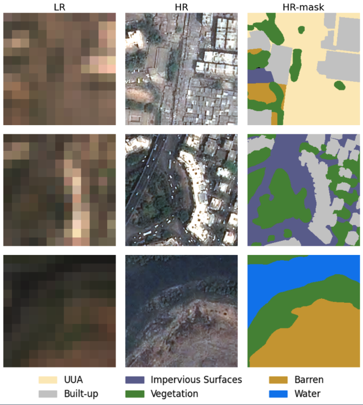

# UUAD: A Cross-Source HR-LR Dataset for Unplanned Urban Area Mapping
### [**Paper**](https://pcsc.uc-bcf.edu.ph/pcsc-proceedings) | [**PDF**](/UUAD_A_Cross_Source_HR_LR_Dataset_for_Unplanned_Urban_Area_Mapping.pdf)

## Overview
UUAD is a comprehensive dataset for unplanned urban area mapping, designed to support machine learning applications for remote sensing. It contains high-resolution (HR) and low-resolution (LR) satellite imagery along with corresponding ground truth masks.

## Abstract
> Unplanned urban area (UUA) mapping using remote sensing has seen significant breakthroughs in recent years. However, achieving high accuracy relies on using high-resolution satellite imagery, which is expensive and not widely accessible. In response, superresolution (SR) techniques have since gained prominence by upscaling low-resolution imagery, however, these approaches still fall short as they rely on HR imagery and their corresponding LR counterparts. Thus, this study provides a review of existing satellite image sources and land use and land cover (LULC) datasets. Additionally, we introduce UUA Dataset, a cross-source HR-LR dataset, including detailed annotations of UUAs in diverse scenes. Moreover, this study observed that UUAs exhibit GLCM features similar to those of other classes, such as built-up areas and roads, underscoring the need for HR imagery in segmentation tasks. Using the datasets proposed in this study, UUA monitoring through remote sensing can be more widespread, contributing to the mitigation of their growth.


## Sample Images from UUAD
<div align="center">
  <figure>
    
  </figure>
</div>


## Dataset Structure
```
UUAD/
├── hr/
│   ├── train/  
│   ├── test/   
│   └── val/    
├── lr/
│   ├── train/ 
│   ├── test/   
│   └── val/   
├── hr-mask/
│   ├── train/ 
│   ├── test/  
│   └── val/   
└── class_dict.csv/
```

## Dataset Specifications
- **Mask Format**: Masks contain RGB bands representing different classes
- **Spatial Coverage**: 9.9 km&sup2; of Mumbai, India
- **Image Format**: PNG


### Dataset Statistics

| Folder | Resolution (m/pixel) | Image Size (pixels) | Train | Test | Validation | Total |
|--------|----------------------|---------------------|-------|------|------------|-------|
| LR     | 10                   | 13 × 13             | 693   | 153  | 144        | 990   |
| HR     | 0.5                  | 256 × 256           | 693   | 153  | 144        | 990   |
| HR-mask| 0.5                  | 256 × 256           | 693   | 153  | 144        | 990   |


## Usage
This dataset can be used for:
- Super-resolution applications
- Unplanned urban area segmentation


## Acknowledgments
The HR imagery and masks in this dataset are sourced from [Mendeley Data](https://data.mendeley.com/datasets/xj2v49zt26/1). We thank the authors for making their data publicly available.


## Contact
For any questions or inquiries, please contact:
macario.cordel@dlsu.edu.ph


## Citation
If you found our work helpful in your research, please consider citing it. Your support is greatly appreciated!
```bibtex
@inproceedings{uuad,
  author    = {Ang Ngo Ching, Josh Darren W. and
               Ting, Sidney Mitchell O. and
               Ogatia, Graham Joshua and
               Jardenil, Aaron Randall and
               Cordel, II, Macario O. and
               Tiam-Lee, Thomas James Z.},
  title     = {{UUAD}: A Cross-Source {HR-LR} Dataset for Unplanned Urban Area Mapping},
  booktitle = {Proceedings of the 25th Philippine Computing Science Congress},
  year      = {2025},
  volume    = {1},
  pages     = {135--142},
  url       = {https://pcsc.uc-bcf.edu.ph/pcsc-proceedings}
}
```